# MOCHA

## Multi-scale Occupancy-Guided Cross-View Hierarchical Alignment

**Occupancy-Guided Self-Supervised LiDAR Representation Learning for Cross-Domain Semantic Segmentation**

MOCHA is a LiDAR-only self-supervised representation-learning framework for outdoor 3D semantic segmentation. It combines exponential-moving-average (EMA) cross-view feature alignment with a lightweight multi-scale local-support objective, then extends the same formulation to heterogeneous multi-dataset pretraining (**MultiMOCHA**) and occupancy-regularized target-domain adaptation (**TargetMOCHA**).

MOCHA is implemented on the Pointcept research stack with PTv3/Utonia-style backbones. **It does not claim a new backbone.** The contribution is the representation-learning, heterogeneous pretraining, target adaptation, evaluation, and deployment framework built around occupancy-guided geometric supervision.

**GitHub:** https://github.com/das-swagat/MOCHA  
**Models:** https://huggingface.co/das-swagat/MOCHA  
**Paper:** manuscript in preparation

> This repository accompanies the MOCHA research release. The public paper link and final citation metadata will be added when available.

---

## What MOCHA Adds

MOCHA is organized around three connected contributions:

1. **MOCHA — occupancy-guided LiDAR self-supervision.**  
   A student-teacher cross-view alignment objective is paired with a compact 3-bit multi-scale local-support target. The auxiliary target is computed directly from point neighborhoods and requires no semantic labels.

2. **MultiMOCHA — heterogeneous outdoor LiDAR pretraining.**  
   The same self-supervised objective is applied across nuScenes, SemanticKITTI, Toronto3D, RELLIS-3D, and SemanticUSL. The canonical **MultiMOCHA-15k** pretraining manifest contains 15,000 exposure entries, with 3,000 entries sampled per dataset. The manifest contains 9,802 unique scan roots.

3. **TargetMOCHA — occupancy-aware target adaptation.**  
   During supervised fine-tuning, a newly initialized target-domain occupancy head regularizes the semantic objective. The occupancy head is training-only and is not required for deployed semantic inference.

The release additionally includes canonical experiment configurations, model provenance, checksum manifests, low-label configurations, Jetson deployment packages, and qualitative examples across six outdoor LiDAR datasets.

---

## Method

### MOCHA

<p align="center">
  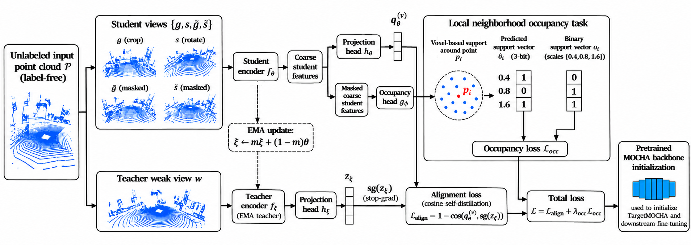
</p>

MOCHA uses student and EMA-teacher views of the same point cloud. Cross-view cosine alignment encourages stable semantic representations, while a lightweight occupancy/local-support target supplies geometric structure before the projection head.

For each point, support is evaluated at three voxel scales. A bit is active when another point occupies the same voxel at that scale, producing a compact multi-scale geometric target.

The canonical source pretraining configuration uses:

- occupancy scales: **0.4 m, 0.8 m, 1.6 m**
- occupancy loss weight: **0.15**
- EMA momentum: **0.996**
- projection dimension: **128**

The objective is:

```math
\mathcal{L}_{\mathrm{MOCHA}}
=
\mathcal{L}_{\mathrm{align}}
+
\lambda_{\mathrm{occ}}\mathcal{L}_{\mathrm{occ}}.
```

### MultiMOCHA

MultiMOCHA retains the same MOCHA objective but trains across heterogeneous outdoor LiDAR sources instead of a single source dataset.

The canonical **MultiMOCHA-15k** manifest contains:

| Dataset | Sampled entries |
|---|---:|
| nuScenes | 3,000 |
| SemanticKITTI | 3,000 |
| Toronto3D | 3,000 |
| RELLIS-3D | 3,000 |
| SemanticUSL | 3,000 |
| **Total** | **15,000** |

The manifest contains repeated sampling where a source dataset has fewer than 3,000 unique scan roots; provenance for the released manifest is retained under `provenance/`.

### TargetMOCHA

<p align="center">
  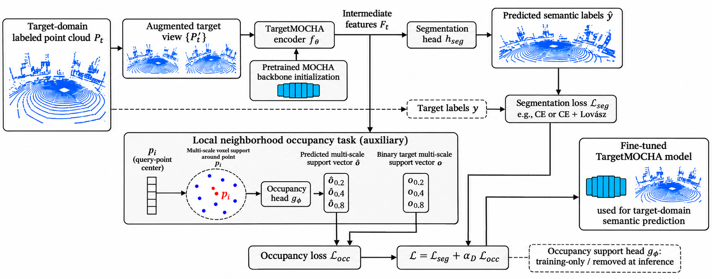
</p>

TargetMOCHA starts from the same MultiMOCHA-15k representation used by the ordinary supervised fine-tuning baseline. It adds a **new target-domain occupancy head** during adaptation rather than reusing the source pretraining head.

For target dataset $D$,

```math
\mathcal{L}_{\mathrm{Target}}^{(D)}
=
\mathcal{L}_{\mathrm{seg}}^{(D)}
+
\alpha_D \mathcal{L}_{\mathrm{occ}}.
```

The target-domain occupancy scales are **0.2 m, 0.4 m, and 0.8 m**. The auxiliary occupancy head is removed from the final semantic inference path.

---

## Main Results

### nuScenes

| Method | mIoU | mAcc | allAcc |
|---|---:|---:|---:|
| Utonia reference | 78.60 | — | — |
| **MOCHA** | **80.57** | **87.89** | **94.48** |

**MOCHA is +1.97 mIoU above the Utonia-based development reference under this protocol.**

The 78.60 result is a development reference under our protocol. The progression is not a controlled component-wise ablation or a protocol-matched comparison with the published Utonia benchmark.

### Cross-Domain Adaptation

| Dataset | MultiMOCHA FT | TargetMOCHA | Change |
|---|---:|---:|---:|
| SemanticKITTI | 59.26 | **59.52** | **+0.26** |
| Toronto3D | 58.42 | **58.96** | **+0.54** |
| RELLIS-3D | 26.67 | **26.78** | **+0.11** |
| SemanticUSL | 23.94 | **24.51** | **+0.57** |

TargetMOCHA gives consistent, modest gains over matched ordinary MultiMOCHA fine-tuning on the four original cross-domain targets.

### DALES

DALES is excluded from MultiMOCHA pretraining and evaluated after supervised downstream adaptation.

| Variant | Single-view mIoU |
|---|---:|
| **MultiMOCHA** | **78.72** |
| TargetMOCHA | 78.69 |

TargetMOCHA does **not** improve the canonical DALES single-view aggregate result.

Under a matched 10-view test-time augmentation protocol:

| Variant | 10-view TTA mIoU |
|---|---:|
| MultiMOCHA | 80.53 |
| **TargetMOCHA** | **80.69** |

The matched TTA gain is **+0.16 mIoU**. TTA is used for research evaluation only and is **not** part of the edge-deployment path.

Detailed protocol notes and canonical model mappings are provided in `MODEL_ZOO.md`, `docs/RESULTS.md`, and `provenance/`.

---

## Qualitative Results

The qualitative release includes the paper-selected nuScenes and four-dataset transfer examples, together with a separate DALES aerial-domain analysis.

### Cross-Dataset Transfer

<p align="center">
  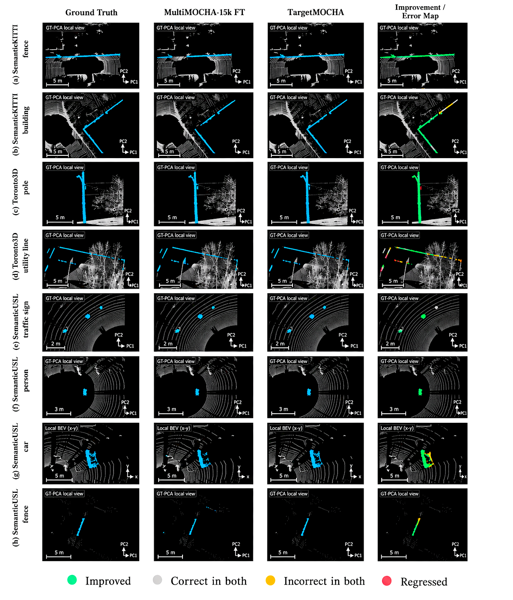
</p>

The cross-dataset figure contains the paper-selected transfer examples from **SemanticKITTI, Toronto3D, and SemanticUSL**. It compares matched baseline and TargetMOCHA predictions on difficult structures and sparse classes across substantially different outdoor LiDAR domains. **RELLIS-3D is included in the quantitative cross-domain evaluation, but it is not shown in this locked qualitative figure.**

### nuScenes

<p align="center">
  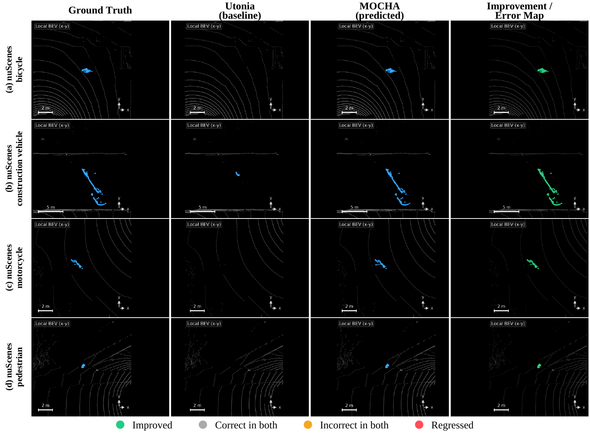
</p>

The nuScenes figure compares the Utonia reference and MOCHA on the paper-selected **bicycle, construction-vehicle, motorcycle, and pedestrian** cases. These examples complement the aggregate +1.97 mIoU result by showing where the representation change affects sparse and operationally relevant classes.

High-resolution PDF versions of the paper qualitative figures are also retained under `assets/`.

### DALES: Full-Tile Aerial Predictions

<table>
<tr>
<td width="50%" align="center">
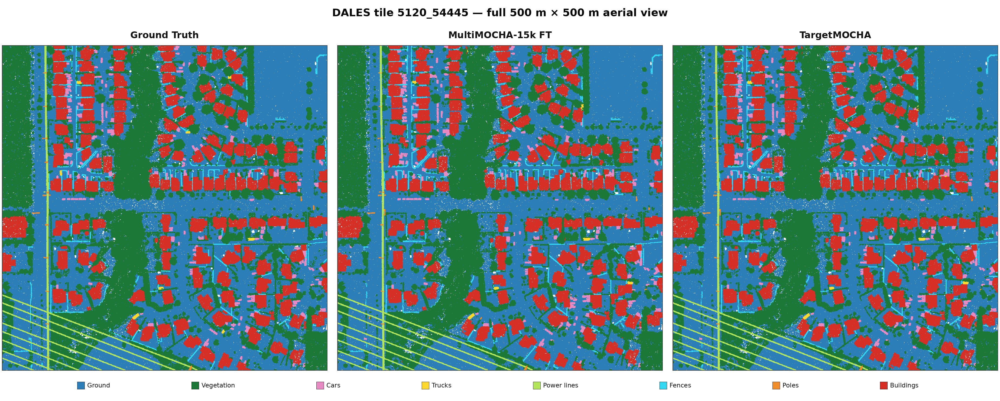
</td>
<td width="50%" align="center">
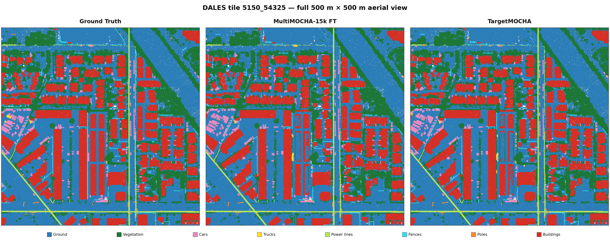
</td>
</tr>
</table>

These two full-tile examples show the spatial consistency of the released DALES models over large aerial scenes rather than only isolated object crops.

### DALES: Selected Local Recovery Examples

<table>
<tr>
<td width="50%" align="center">
<b>Cars</b><br>
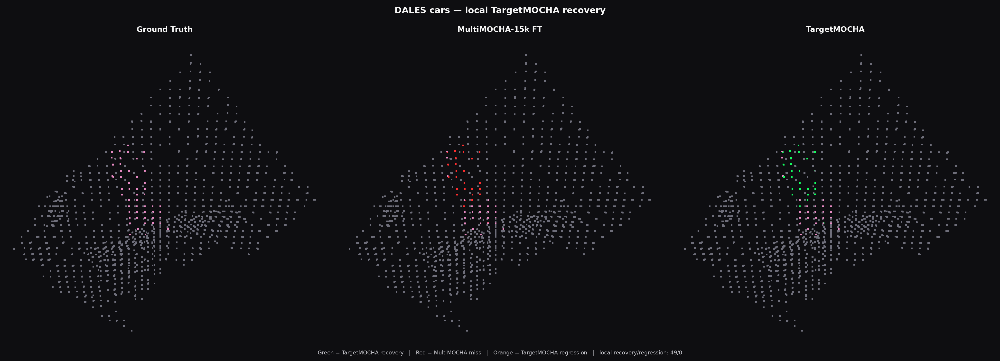
</td>
<td width="50%" align="center">
<b>Trucks</b><br>
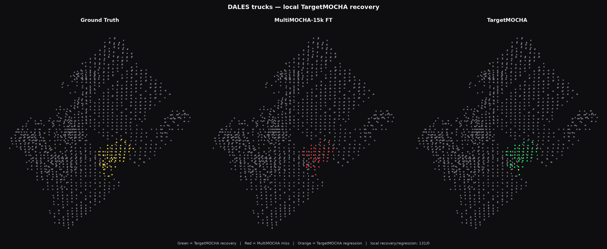
</td>
</tr>
<tr>
<td width="50%" align="center">
<b>Power lines</b><br>
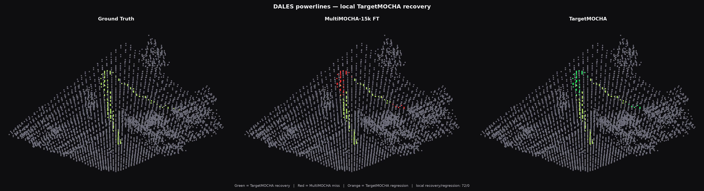
</td>
<td width="50%" align="center">
<b>Fences</b><br>
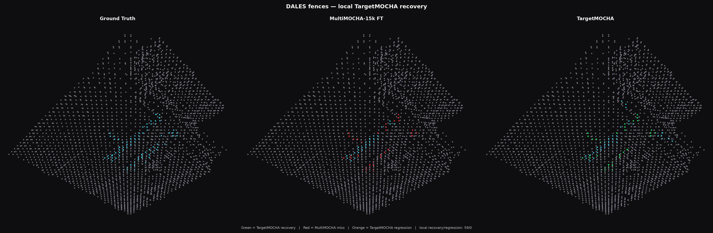
</td>
</tr>
<tr>
<td colspan="2" align="center">
<b>Poles</b><br>
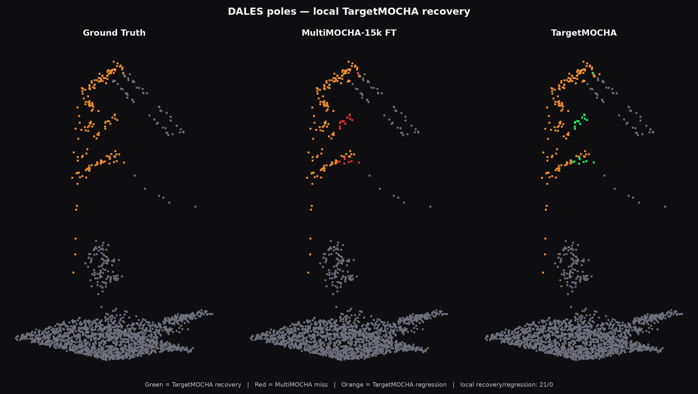
</td>
</tr>
</table>

These crops are **selected local recovery examples**, not claims of aggregate class-wise improvement. In the matched DALES TTA evaluation, the clearest class-level gains are for **trucks (+2.29 IoU)** and **cars (+0.95 IoU)**. Power-line, fence, and pole crops are included to illustrate localized corrections that occur even when their dataset-level class IoU does not improve overall.

---

## Released Models

Large checkpoints are hosted on Hugging Face rather than stored in GitHub:

**https://huggingface.co/das-swagat/MOCHA**

### Downstream Models

| Model ID | Dataset | Family | Input |
|---|---|---|---|
| `nuscenes-mocha` | nuScenes | MOCHA | 9 channels |
| `semkitti-multimocha` | SemanticKITTI | MultiMOCHA | 9 channels |
| `semkitti-targetmocha` | SemanticKITTI | TargetMOCHA | 9 channels |
| `toronto-multimocha` | Toronto3D | MultiMOCHA | 4 channels |
| `toronto-targetmocha` | Toronto3D | TargetMOCHA | 4 channels |
| `rellis-multimocha` | RELLIS-3D | MultiMOCHA | 4 channels |
| `rellis-targetmocha` | RELLIS-3D | TargetMOCHA | 4 channels |
| `usl-multimocha` | SemanticUSL | MultiMOCHA | 9 channels |
| `usl-targetmocha` | SemanticUSL | TargetMOCHA | 9 channels |
| `dales-multimocha` | DALES | MultiMOCHA | 4 channels |
| `dales-targetmocha` | DALES | TargetMOCHA | 4 channels |

Pretraining checkpoints are also released:

- `mocha-pretrain`
- `multimocha-15k-pretrain`

These are representation-learning checkpoints for downstream initialization and are **not directly deployable semantic-segmentation models**.

### List Available Models

```bash
python3 tools/list_models.py
```

For full metadata:

```bash
python3 tools/list_models.py --details
```

Inspect one model:

```bash
python3 tools/list_models.py --model semkitti-targetmocha
```

### Download a Model

```bash
python3 tools/download_weights.py --model semkitti-targetmocha
```

The helper resolves the canonical Hugging Face artifact, downloads the checkpoint, and verifies its SHA256 checksum.

Direct download through `huggingface_hub` is also supported:

```python
from huggingface_hub import hf_hub_download

checkpoint = hf_hub_download(
    repo_id="das-swagat/MOCHA",
    filename="downstream/semantickitti/targetmocha/model_best.pth",
)
```

---

## Dataset Compatibility and Preprocessing

Released checkpoints must be paired with their corresponding dataset and configuration.

| Dataset | Model input | Test voxelization | Notes |
|---|---|---:|---|
| nuScenes | `coord + color + normal` | 0.01 m | released downstream model uses 3 LiDAR sweeps |
| SemanticKITTI | `coord + color + normal` | 0.01 m | 9-channel model input |
| SemanticUSL | `coord + color + normal` | 0.01 m | 9-channel model input |
| Toronto3D | `coord + strength` | 0.02 m | 4-channel model input |
| RELLIS-3D | `coord + strength` | 0.01 m | 4-channel model input |
| DALES | `coord + strength` | 0.02 m | PointSSM-style DALES pipeline |

Do not assume arbitrary raw XYZ point clouds can be passed directly to a released checkpoint. The released configuration is the authoritative specification for feature construction, voxelization, transforms, class definitions, and evaluation settings.

See `docs/PREPROCESSING.md` and `configs/paper/`.

---

## Installation

MOCHA is implemented as an extension of the Pointcept research stack. This repository contains the MOCHA-specific model, dataset, configuration, provenance, and deployment files required for the released experiments. It is **not presented as a complete independent redistribution of Pointcept**.

Validated research environments are recorded in:

- `environment/environment_pointcept.yml`
- `environment/environment_utonia.yml`
- `ENVIRONMENT.md`

Lightweight repository utilities require:

```bash
python3 -m pip install -r requirements.txt
```

Training and evaluation requirements are described in `requirements-train.txt` and `docs/INSTALL.md`. CUDA-specific packages such as PyTorch and spconv should be installed for the target CUDA/platform combination.

---

## Edge Deployment

MOCHA-family checkpoints were validated on an **NVIDIA Jetson Orin Nano Super
Developer Kit (8 GB) in 25 W mode** across all six evaluation domains.

| Dataset | Deployed model | mIoU | Points | Median (ms) | Throughput (kPts/s) | Peak CUDA (MiB) |
|---|---|---:|---:|---:|---:|---:|
| nuScenes | MOCHA | 80.57 | 4,000 | 1135.2 | 3.52 | 1080.9 |
| SemanticKITTI | TargetMOCHA | 59.52 | 16,000 | 2103.9 | 7.61 | 1064.3 |
| Toronto3D | TargetMOCHA | 58.96 | 11,035 | 970.9 | 11.37 | 836.5 |
| RELLIS-3D | TargetMOCHA | 26.78 | 9,000 | 2100.2 | 4.29 | 1242.1 |
| SemanticUSL | TargetMOCHA | 24.51 | 5,000 | 1364.2 | 3.67 | 1109.7 |
| DALES | MultiMOCHA FT | 78.72 | 18,000 | 688.4 | 26.15 | 838.3 |

The validated inference policy uses:

- FP16 checkpoint storage;
- FP32-resident model parameters;
- CUDA FP16 autocast during inference;
- no test-time augmentation;
- no TensorRT or INT8 quantization;
- the TargetMOCHA occupancy head omitted from semantic inference.

TargetMOCHA therefore introduces auxiliary occupancy supervision during
training without requiring an auxiliary occupancy branch at deployment.

Latency is synchronized model-forward inference after benchmark input
preparation; it is **not** end-to-end sensor-to-prediction latency. The
dataset-specific point counts above are validated operating points, not
universal hardware limits.

See [`docs/EDGE_BENCHMARKS.md`](docs/EDGE_BENCHMARKS.md) for the complete
paired benchmark, methodology, p95 latency, stability observations, and
limitations. Machine-readable results are provided in
[`benchmarks/jetson_orin_nano_super.json`](benchmarks/jetson_orin_nano_super.json).

Checkpoint-bearing Jetson packages are distributed through the corresponding
Hugging Face release rather than this Git repository.

---

## Repository Structure

```text
MOCHA/
├── assets/              architecture and qualitative figures
│   └── dales/           DALES overview and local recovery examples
├── configs/             canonical experiment configurations
│   ├── pretraining/
│   ├── paper/
│   └── low_label/
├── docs/                installation, preprocessing and results
├── edge/                Jetson deployment packages
├── environment/         validated research and edge environments
├── provenance/          model/config/source provenance and hashes
├── scripts/             data and pretraining utilities
├── src/                 MOCHA Pointcept extension sources
├── tools/               model registry and download utilities
├── DATASETS.md
├── MODEL_ZOO.md
├── ENVIRONMENT.md
├── SHA256SUMS.txt
└── README.md
```

---

## Reproducibility and Provenance

Canonical release metadata is maintained under `provenance/`, including:

- source-model provenance
- canonical pretraining checkpoints
- canonical downstream checkpoints
- exact experiment configuration mappings
- source/configuration SHA256 hashes
- artifact checksum manifests

The Hugging Face model repository contains the large released checkpoints and edge-package archives.

The public release does not require private infrastructure paths or credentials for artifact download.

---

## Datasets

MOCHA does **not redistribute research datasets**. Users must obtain each dataset from its original provider and comply with the corresponding license and terms.

Dataset preparation and compatibility information is maintained in `DATASETS.md` and `docs/PREPROCESSING.md`.

The evaluated datasets are:

- nuScenes
- SemanticKITTI
- Toronto3D
- RELLIS-3D
- SemanticUSL
- DALES

---

## Scope of Claims

The release is intended to make the paper claims directly auditable.

In particular:

- MOCHA is a representation-learning framework, **not a new backbone**.
- The primary nuScenes result is **80.57 mIoU**, a **+1.97 mIoU** improvement over the matched Utonia reference.
- TargetMOCHA improves the four original cross-domain targets by **+0.11 to +0.57 mIoU** under the reported full-label protocols.
- On DALES, MultiMOCHA is slightly stronger in canonical single-view evaluation (**78.72 vs. 78.69 mIoU**); TargetMOCHA is slightly stronger under matched 10-view TTA (**80.69 vs. 80.53 mIoU**).
- DALES local qualitative recoveries for power lines, fences, and poles are not presented as aggregate class-level gains.
- Test-time augmentation is not used in the edge-deployment results.
- The TargetMOCHA occupancy head is training-only.

This distinction between aggregate metrics, local qualitative evidence, and deployment settings is maintained throughout the repository.

---

## Licensing and Third-Party Components

MOCHA builds on third-party research software, including Pointcept and PTv3/Utonia-derived components. Code licensing, model-weight terms, dataset terms, and third-party notices are documented separately so that rights applicable to source code, released weights, and external datasets are not conflated.

The finalized public release will include:

- `LICENSE`
- `LICENSE-WEIGHTS.md`
- `THIRD_PARTY_NOTICES.md`

No third-party datasets are distributed in this repository.

---

## Citation

Citation metadata will be finalized together with the manuscript metadata. `CITATION.cff` is included in the repository structure and will contain the final author list, title, and publication information before the repository is made public.

---

## Status

MOCHA is maintained as a public research release accompanying the manuscript. Paper and citation links will be updated as the manuscript progresses from submission to public preprint and final publication.

The public release provides the source modifications, canonical configurations, model weights, provenance records, qualitative figures, reproducibility metadata, and deployment artifacts accompanying the study.
